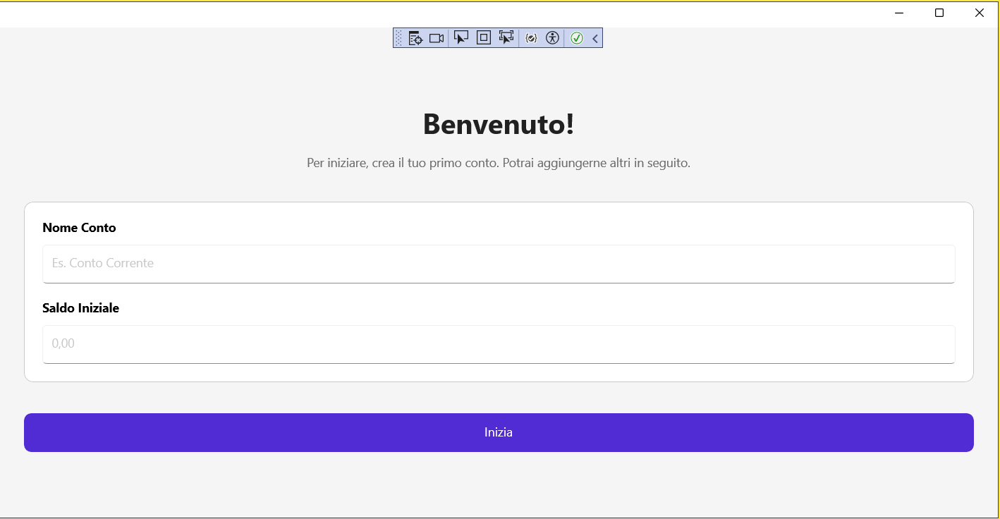

# Technical Audit 2026

Audit tecnico del workspace: blog statico in HTML/CSS/Vanilla JS con tool di refactoring in C#.

## Executive summary

Il progetto ha una buona base SEO tecnica e una struttura editoriale già solida, ma presenta criticità concrete su tre fronti:

1. **Performance/Core Web Vitals**: CSS pesante e duplicato, hero con `background-attachment: fixed`, preload incoerenti e risorse esterne non sempre ottimizzate.
2. **Manutenibilità CSS/HTML**: `base.css` contiene duplicazioni, override ripetuti e variabili legacy poco coerenti; alcune pagine usano inline CSS che dovrebbe essere consolidato.
3. **Tooling C#**: `BlogRefactorTool/Program.cs` usa regex su HTML come se fosse testo lineare, senza protezioni sufficienti contro sostituzioni indesiderate e corruzione dell’output.

Le priorità sotto sono ordinate per impatto reale su utenti, SEO e rischio di regressione.

---

## Priorità Alta / Bloccante

### 1) CSS globale troppo ridondante e con conflitti di specificità

**File impattati**: [`base.css`](base.css), [`index.html`](index.html:1), [`blog/development.html`](blog/development.html:1), [`risorse.html`](risorse.html:1)

**Problema**

Il file [`base.css`](base.css) contiene blocchi duplicati e regole sovrapposte che aumentano il costo di manutenzione e il rischio di side effect:

- `.blog-signature` è definita più volte con stili diversi.
- `.hero-section h1`, `.about-container`, `.passion-card-bs`, `.blog-header` e altri selettori sono duplicati o ridefiniti in più punti.
- Sono presenti variabili duplicate o incoerenti, ad esempio `--footer-bg` definita due volte nel `:root`.
- Alcuni selettori usano `!important` per compensare conflitti strutturali, segnale di architettura CSS fragile.

**Perché è debito tecnico**

Questo rende il CSS più difficile da prevedere, incrementa il rischio di regressioni cross-page e complica il refactoring del tema o l’introduzione di varianti future.

**Snippet production-ready per risolvere**

```css
/* base.css: normalizza le variabili e rimuove alias duplicati */
:root {
  --bg-page: #f8fafc;
  --surface: #ffffff;
  --surface-variant: #f1f5f9;
  --text-primary: #0f172a;
  --text-secondary: #475569;
  --text-muted: #64748b;
  --primary: #2563eb;
  --primary-hover: #1d4ed8;
  --secondary: #ea580c;
  --secondary-hover: #c2410c;
  --border-subtle: #e2e8f0;
  --radius-md: 12px;
  --radius-lg: 16px;
  --shadow-sm: 0 1px 2px rgba(0, 0, 0, 0.05);
  --shadow-md: 0 4px 6px -1px rgba(0, 0, 0, 0.1);
  --transition-standard: 0.2s cubic-bezier(0.2, 0, 0, 1);
}

/* definire una sola volta i blocchi di componente */
.blog-signature {
  background: var(--surface-variant);
  border: 1px solid var(--border-subtle);
  border-left: 4px solid var(--primary);
  border-radius: var(--radius-md);
  box-shadow: var(--shadow-sm);
  padding: 1.25rem;
  color: var(--text-secondary);
}

/* evitare override duplicati: una sola definizione per header hub */
.blog-header {
  width: 100%;
  padding: 4rem 1.5rem;
  margin-bottom: 3rem;
  border-radius: 0;
}
```

**Azione consigliata**

- Consolidare i componenti duplicati in una sola definizione per blocco.
- Sostituire le variabili legacy con alias minimi e documentati.
- Eliminare `!important` dove possibile, soprattutto in header/footer.

---

### 2) Hero home con pattern potenzialmente costoso su mobile

**File impattati**: [`base.css`](base.css), [`index.html`](index.html:1)

**Problema**

La hero usa:

- `background-attachment: fixed;`
- immagine di sfondo caricata via CSS
- overlay e animazioni al primo paint

Su mobile il `fixed` è spesso costoso o disabilitato dal browser, e l’immagine di background non consente facilmente `srcset`, `sizes` o `fetchpriority` granulari.

**Perché è debito tecnico**

Può peggiorare LCP, introdurre repaint costosi e ridurre la fluidità su connessioni mobili o device mediobassi.

**Snippet production-ready per risolvere**

```html
<!-- index.html: sostituire la hero CSS background con immagine reale -->
<section class="hero-section text-white text-center">
  <picture class="hero-media">
    <source type="image/webp" srcset="/images/index/index2-960.webp 960w, /images/index/index2-1600.webp 1600w" sizes="100vw">
    
  </picture>
  <div class="hero-overlay" aria-hidden="true"></div>
  <div class="container">...</div>
</section>
```

```css
/* base.css */
.hero-section {
  position: relative;
  min-height: 75vh;
  display: grid;
  place-items: center;
  overflow: clip;
}

.hero-media,
.hero-media img {
  position: absolute;
  inset: 0;
  width: 100%;
  height: 100%;
  object-fit: cover;
}

@media (max-width: 768px) {
  .hero-section {
    min-height: auto;
  }
}
```

**Azione consigliata**

- Evitare `background-attachment: fixed` su mobile.
- Usare immagini responsive reali con dimensioni esplicite.
- Ridurre le animazioni al primo paint o rimandarle con `prefers-reduced-motion`.

---

### 3) `Program.cs` usa regex aggressive su HTML e può corrompere l’output

**File impattati**: [`BlogRefactorTool/Program.cs`](BlogRefactorTool/Program.cs:1)

**Problema**

Il tool legge e riscrive ogni file con `Regex.Replace` su pattern ampi come:

- `<header[^>]*>.*?</header>`
- sostituzioni basate su `articleTitle` derivato da `title`/`h1`
- cancellazione di `<h1>` con pattern non contestualizzato al DOM

Questo approccio è fragile in presenza di:

- header annidati o markup non standard
- script/style contenenti stringhe simili a tag HTML
- più `<header>` validi nella stessa pagina
- differenze di encoding o line ending

**Perché è debito tecnico**

Un refactor tool deve essere idempotente e conservativo. Qui invece una regex troppo larga può alterare parti corrette della pagina o rimuovere contenuti legittimi.

**Snippet production-ready per risolvere**

```csharp
using System.Text;
using System.Text.RegularExpressions;

var options = RegexOptions.IgnoreCase | RegexOptions.CultureInvariant | RegexOptions.Compiled;

static string ReplaceSingleHeader(string html, string replacement)
{
    var pattern = @"<header\b[^>]*class\s*=\s*['\"][^'\"]*(article-hero|blog-header)[^'\"]*['\"][^>]*>[\s\S]*?<\/header>";
    return Regex.Replace(html, pattern, replacement, RegexOptions.IgnoreCase | RegexOptions.CultureInvariant);
}

static string RemoveDuplicateH1(string html, string articleTitle)
{
    var pattern = $@"<h1\b[^>]*>\s*{Regex.Escape(articleTitle)}\s*<\/h1>";
    return Regex.Replace(html, pattern, "", RegexOptions.IgnoreCase | RegexOptions.CultureInvariant);
}
```

**Azione consigliata**

- Limitare il tool ai file target con whitelist esplicita.
- Usare backup prima di scrivere.
- Preferire parsing HTML vero quando possibile, o almeno una pipeline più conservativa con test su campioni reali.

---

## Priorità Media

### 4) Preload e include esterni non sempre coerenti tra le pagine

**File impattati**: [`index.html`](index.html:1), [`blog/development.html`](blog/development.html:1), [`risorse.html`](risorse.html:1)

**Problema**

La home pre-carica Bootstrap e `base.css`, ma usa path incoerenti come `../base.css?v=2.0` e `../images/...` pur essendo il file nella root. Alcune pagine caricano anche font iconografici multipli e font esterni non sempre in modo uniforme.

**Perché è debito tecnico**

Path errati o incoerenti possono causare 404 o cache inefficace. Inoltre doppie librerie di icone e font impattano il critical rendering path.

**Snippet production-ready per risolvere**

```html
<!-- usare path coerenti dalla root -->
<link rel="preload" href="/base.css?v=2.0" as="style">
<link rel="stylesheet" href="/base.css?v=2.0">

<link rel="preload" href="/images/index/index2.webp" as="image" fetchpriority="high">
```

**Azione consigliata**

- Normalizzare tutti i path assoluti o relativi per pagina.
- Eliminare librerie duplicate se una sola basta.
- Preload solo per risorse davvero critiche.

---

### 5) Immagini: buona base, ma mancano strategie uniformi per CLS e responsive delivery

**File impattati**: [`index.html`](index.html:1), [`blog/development.html`](blog/development.html:1), [`risorse.html`](risorse.html:1), immagini in [`images/`](images/)

**Problema**

Molte immagini hanno `alt`, ma l’uso di `width`/`height` non è uniforme e in alcune pagine le immagini sono ancora controllate via inline style. Alcune immagini sono WebP, altre no; non si vede un pattern consistente per `loading="lazy"` sui contenuti below-the-fold.

**Perché è debito tecnico**

Senza dimensioni esplicite e lazy loading coerente il layout può shiftare e il caricamento mobile può diventare più pesante del necessario.

**Snippet production-ready per risolvere**

```html

```

```html
<picture>
  <source type="image/webp" srcset="/images/index/onboarding_screenshot.webp">
  
</picture>
```

**Azione consigliata**

- Uniformare l’uso di `loading="lazy"` per tutte le immagini non LCP.
- Inserire sempre `width` e `height` o `aspect-ratio`.
- Convertire i PNG/JPG non critici in WebP dove possibile.

---

### 6) SEO tecnica: meta e OG buoni ma da rendere sistematici su tutte le pagine

**File impattati**: [`index.html`](index.html:1), [`blog/development.html`](blog/development.html:1), [`risorse.html`](risorse.html:1), resto degli HTML del blog

**Problema**

La home ha `title`, description, canonical, OG e Twitter card. Altre pagine hanno implementazioni meno omogenee. Serve verificare:

- unicità di `title` e description per ogni pagina
- canonical coerente e assoluto
- `og:image` sempre presente e assoluto
- gerarchia heading non duplicata da header dinamici

**Perché è debito tecnico**

La mancanza di uniformità riduce CTR social, chiarezza per crawler e qualità dell’indicizzazione.

**Snippet production-ready per risolvere**

```html
<title>Unit Testing in C# | Il Viaggio del Programmatore</title>
<meta name="description" content="Guida pratica a xUnit, AAA e test automatizzati in C# per evitare regressioni e migliorare la qualità del codice.">
<link rel="canonical" href="https://www.ilviaggiodelprogrammatore.com/blog/dev-section/018-unit-testing-csharp.html">
<meta property="og:type" content="article">
<meta property="og:title" content="Unit Testing in C# | Il Viaggio del Programmatore">
<meta property="og:description" content="Guida pratica a xUnit, AAA e test automatizzati in C#.">
<meta property="og:image" content="https://www.ilviaggiodelprogrammatore.com/images/blog/development/unit-testing-cover.webp">
```

**Azione consigliata**

- Creare un template SEO standard per home, hub e article page.
- Verificare che i file generati dal tool non duplicano `h1` o heading principali.

---

## Priorità Bassa / Estetica

### 7) Inline CSS e classi utility sparse riducono la pulizia del DOM styling

**File impattati**: [`index.html`](index.html:1), [`blog/development.html`](blog/development.html:1), [`risorse.html`](risorse.html:1)

**Problema**

Nel markup sono presenti numerosi `style="..."` inline e piccoli blocchi `<style>` page-specifici. Questo è accettabile per prototipi, ma nel tempo frammenta la UI.

**Perché è debito tecnico**

Ogni eccezione inline è una futura fonte di divergenza tra pagine e rende più difficile la manutenzione del design system.

**Snippet production-ready per risolvere**

```css
/* base.css */
.section-heading-accent {
  border-left: 5px solid var(--primary);
  padding-left: 0.75rem;
}

.card-media-fixed {
  height: 180px;
  object-fit: cover;
}
```

```html
<h3 class="section-heading-accent">Tutti gli articoli</h3>

```

**Azione consigliata**

- Spostare gli stili ripetuti in `base.css`.
- Usare utility class locali solo se davvero specifiche e documentate.

---

### 8) Accessibilità migliorabile su componenti interattivi e animazioni decorative

**File impattati**: [`index.html`](index.html:1), [`blog/development.html`](blog/development.html:1), [`base.css`](base.css)

**Problema**

Le animazioni reveal e alcuni elementi decorativi non sembrano controllati in modo completo da `prefers-reduced-motion`. Inoltre le icone usate come decorazione non sempre hanno un ruolo esplicito di presentazione.

**Perché è debito tecnico**

L’accessibilità non è solo conformità: riduce il costo cognitivo e migliora la fruizione su device meno potenti.

**Snippet production-ready per risolvere**

```css
@media (prefers-reduced-motion: reduce) {
  *, *::before, *::after {
    animation-duration: 0.01ms !important;
    animation-iteration-count: 1 !important;
    transition-duration: 0.01ms !important;
    scroll-behavior: auto !important;
  }
}
```

```html
<i class="fas fa-search" aria-hidden="true"></i>
```

**Azione consigliata**

- Nascondere dal tree accessibile tutte le icone decorative.
- Garantire un focus visibile coerente sui link e bottoni custom.

---

## Note operative sul tooling C#

### Rischi specifici in `BlogRefactorTool/Program.cs`

**File**: [`BlogRefactorTool/Program.cs`](BlogRefactorTool/Program.cs:1)

Rischi da trattare prima di usarlo su larga scala:

- `Directory.GetFiles(..., SearchOption.AllDirectories)` include qualsiasi HTML, ma la whitelist è gestita dopo la discovery: meglio filtrare prima.
- `File.ReadAllText` / `WriteAllText` senza encoding esplicito possono introdurre differenze se il file non è UTF-8 puro.
- Nessun backup o dry-run.
- Nessun logging strutturato dei file modificati e delle sostituzioni effettive.
- Le regex non sono ancorate a una struttura HTML valida, quindi il tool è fragile davanti a markup complesso.

**Snippet consigliato per hardening**

```csharp
var encoding = new UTF8Encoding(encoderShouldEmitUTF8Identifier: false);
var original = File.ReadAllText(filePath, encoding);

var updated = ProcessHtml(original);
if (updated != original)
{
    var backupPath = filePath + ".bak";
    File.Copy(filePath, backupPath, overwrite: true);
    File.WriteAllText(filePath, updated, encoding);
}
```

---

## Priorità consigliata di intervento

1. Consolidare [`base.css`](base.css) e rimuovere duplicazioni.
2. Mettere in sicurezza [`BlogRefactorTool/Program.cs`](BlogRefactorTool/Program.cs:1) con backup, encoding esplicito e regex più conservative.
3. Ristrutturare la hero della home per ridurre costo LCP e repaint su mobile.
4. Uniformare SEO meta/OG/canonical su tutte le pagine article e hub.
5. Standardizzare immagini responsive, lazy loading e dimensioni esplicite.

## Conclusione

Il sito è già ben posizionato editorialmente, ma può diventare molto più robusto con un refactoring mirato su CSS globale, performance della hero e sicurezza del tool C#. Il miglior ritorno immediato arriva dalla riduzione delle duplicazioni in [`base.css`](base.css) e dall’hardening del refactor tool in [`BlogRefactorTool/Program.cs`](BlogRefactorTool/Program.cs:1).
